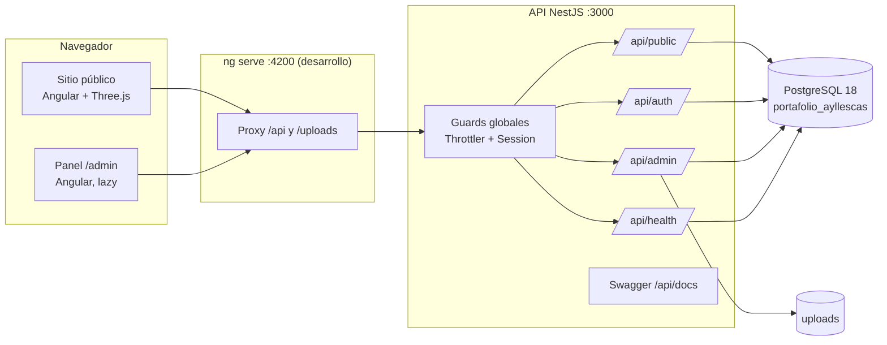

# Arquitectura



## Separación de responsabilidades

| Repositorio | Contenido |
|---|---|
| `portafolio-backend` | API REST NestJS 11 + Prisma 6, independiente del frontend. Incluye `database/` (scripts para crear el rol y las bases locales; `database/local/` es privado e ignorado por Git) y `docs/` (documentación técnica y manual). |
| `portafolio-front` | Aplicación Angular 20 (standalone, signals, SCSS). Sus pruebas E2E levantan la API desde `../backend` o desde `BACKEND_DIR`. |

## Backend

```
src (portafolio-backend)
├── main.ts / app.setup.ts     arranque; pipeline HTTP compartido con las pruebas
├── config/                    variables de entorno validadas al iniciar
├── prisma/                    PrismaService (conexión)
├── common/                    filtro de errores, validación, sobre de respuesta,
│                              paginación, ordenamiento seguro, slugs, sanitización
├── auth/                      login/logout/me, Argon2id, JWT en cookie, guard global
├── admin-users/               cambio de contraseña + CLI admin:create
├── health/                    /api/health
├── public/                    lectura pública (solo contenido publicado)
├── profile/                   perfil, configuración del sitio, destacados
├── experiences/ education/ certifications/ skills/ technologies/ projects/ social-links/
├── contact-messages/          envío público + bandeja administrativa
├── media/                     subida de imágenes y PDF validados por contenido
└── cli/create-admin.ts        alta/restablecimiento del administrador
```

**Flujo de una petición:** Helmet → cookie-parser → CORS (solo `http://localhost:4200`) →
ThrottlerGuard → SessionGuard (deniega por defecto; `@Public()` es la única excepción) →
ValidationPipe (whitelist + forbidNonWhitelisted + transformación) → controlador → servicio →
Prisma → `ResponseEnvelopeInterceptor` (`{ data }` o `{ data, meta }`) o `AllExceptionsFilter`
(`{ error: { statusCode, code, message, details } }`).

## Frontend

```
src/app (portafolio-front)
├── core/          auth (store de sesión, guard), http (interceptores, ApiError),
│                  i18n (diccionario es), seo, ui (tema, movimiento reducido, avisos)
├── shared/        íconos SVG, tarjeta de proyecto, estados de carga/error, pipe de periodos
├── public/        shell, secciones de inicio, detalle de proyecto, hoja de vida, escena 3D
└── admin/         recursos declarativos, listado y formulario genéricos, login, mensajes
```

- **Rutas diferidas:** cada página y todo `/admin` se cargan bajo demanda; Three.js va en su
  propio chunk y solo se descarga si hay WebGL.
- **Estado:** signals (`PortfolioStore`, `SessionStore`); sin librerías de estado adicionales.
- **Datos:** todo el contenido profesional proviene de `/api/public/portfolio`; ningún componente
  contiene datos del CV escritos a mano.
- **Panel declarativo:** cada recurso se define una vez en `admin/resources/resources.ts`
  (campos, columnas, validaciones). Un listado y un formulario genéricos los interpretan, lo que
  evita once pantallas CRUD duplicadas.

## Escena Three.js

`public/hero-scene/network-scene.ts`: fondo decorativo del hero con cinco bloques (uno por capa
de una solución: interfaz, servicios, datos, pruebas y despliegue) iluminados por una luz cálida
que orbita lentamente. Geometría real con materiales físicos, sin video ni imágenes externas.
Un velo CSS mantiene el texto legible y la escena no recibe eventos del puntero.

- En pantallas de hasta 900 px usa una versión ligera: tres bloques, sin antialias, menor
  `devicePixelRatio` y sin esfera visible.
- Se carga con `import()` dinámico solo si hay WebGL; si no, se muestra un SVG estático.
- Bucle `requestAnimationFrame` fuera de la zona de Angular (sin detección de cambios por frame).
- Se pausa con `IntersectionObserver` (fuera de pantalla) y `visibilitychange` (pestaña oculta).
- `prefers-reduced-motion`: se dibuja un único fotograma estático y no hay animación.
- Menos nodos, sin antialias y `devicePixelRatio` limitado en pantallas pequeñas.
- `aria-hidden`, sin eventos de puntero sobre la escena y contenedor con `overflow: hidden`.
- Si se pierde el contexto WebGL, cambia automáticamente a la alternativa SVG.
