# Modelo de datos

Base de datos: **PostgreSQL 18**. Esquema definido en
[`backend/prisma/schema.prisma`](../backend/prisma/schema.prisma) y aplicado por las
migraciones de [`backend/prisma/migrations`](../backend/prisma/migrations).

- Tablas y columnas en `snake_case`; modelos de Prisma en `camelCase`.
- Claves primarias UUID (no revelan cantidad ni orden de registros).
- Campos de auditoría `created_at` / `updated_at` (`timestamptz`) en todas las entidades editables.
- Publicación con `is_published` y orden manual con `display_order` en todo lo que se muestra en el sitio.

## Diagrama entidad-relación

```mermaid
erDiagram
    ADMIN_USERS {
        uuid id PK
        varchar name
        varchar email UK "siempre en minúsculas"
        varchar password_hash "Argon2id"
        bool is_active
        int token_version "revoca sesiones"
        timestamptz last_login_at
    }
    SITE_SETTINGS {
        int id PK "singleton = 1"
        varchar site_title
        varchar site_description
        varchar og_image_url
        enum default_theme
        varchar default_locale
        bool contact_form_enabled
    }
    PROFILE {
        int id PK "singleton = 1"
        varchar full_name
        varchar professional_title
        varchar short_bio
        text long_bio
        varchar location "solo ciudad/país"
        varchar public_email
        varchar phone
        bool is_phone_public
        varchar availability
        varchar profile_image_url
        varchar cv_file_url
    }
    PROFILE_HIGHLIGHTS {
        uuid id PK
        enum kind "WORK_STYLE | VALUE | INTEREST"
        varchar title
        varchar description
        int display_order
        bool is_published
    }
    SOCIAL_LINKS {
        uuid id PK
        enum platform
        varchar label
        varchar url "http(s)"
        int display_order
        bool is_published
    }
    EXPERIENCES {
        uuid id PK
        varchar company
        varchar position
        varchar location
        enum employment_type
        enum work_mode
        date start_date
        date end_date
        bool is_current
        enum date_precision
        varchar summary
        int display_order
        bool is_published
    }
    EXPERIENCE_ITEMS {
        uuid id PK
        uuid experience_id FK
        enum kind "RESPONSIBILITY | ACHIEVEMENT"
        varchar content
        int display_order
    }
    EXPERIENCE_TECHNOLOGIES {
        uuid experience_id PK, FK
        uuid technology_id PK, FK
    }
    EDUCATION {
        uuid id PK
        varchar institution
        varchar program
        varchar degree
        enum status
        date start_date
        date end_date
        enum date_precision
        int display_order
        bool is_published
    }
    CERTIFICATIONS {
        uuid id PK
        varchar name
        varchar issuer
        date issue_date
        date expiration_date
        varchar credential_id
        varchar credential_url
        int display_order
        bool is_published
    }
    SKILL_CATEGORIES {
        uuid id PK
        varchar name UK
        varchar slug UK
        int display_order
    }
    SKILLS {
        uuid id PK
        uuid category_id FK
        varchar name
        varchar slug UK
        varchar proficiency_label "cualitativo, sin %"
        decimal years_of_experience "solo si se confirma"
        bool is_featured
        int display_order
        bool is_published
    }
    TECHNOLOGIES {
        uuid id PK
        varchar name UK
        varchar slug UK
        varchar icon
    }
    PROJECTS {
        uuid id PK
        varchar title
        varchar slug UK
        varchar short_description
        text full_description
        varchar problem
        varchar solution
        varchar role
        enum category
        enum status
        varchar repository_url
        varchar live_url
        varchar cover_image_url
        date start_date
        date end_date
        bool is_featured
        bool is_published "borrador por defecto"
        int display_order
    }
    PROJECT_TECHNOLOGIES {
        uuid project_id PK, FK
        uuid technology_id PK, FK
    }
    PROJECT_RESPONSIBILITIES {
        uuid id PK
        uuid project_id FK
        varchar content
        int display_order
    }
    PROJECT_IMAGES {
        uuid id PK
        uuid project_id FK
        varchar image_url
        varchar alt_text "obligatorio"
        varchar caption
        int display_order
    }
    CONTACT_MESSAGES {
        uuid id PK
        varchar name
        varchar email
        varchar subject
        varchar message
        enum status "NEW | READ | ARCHIVED"
        timestamptz read_at
        timestamptz created_at
    }

    EXPERIENCES ||--o{ EXPERIENCE_ITEMS : "contiene (cascade)"
    EXPERIENCES ||--o{ EXPERIENCE_TECHNOLOGIES : "usa (cascade)"
    TECHNOLOGIES ||--o{ EXPERIENCE_TECHNOLOGIES : "restrict"
    SKILL_CATEGORIES ||--o{ SKILLS : "agrupa (restrict)"
    PROJECTS ||--o{ PROJECT_TECHNOLOGIES : "usa (cascade)"
    TECHNOLOGIES ||--o{ PROJECT_TECHNOLOGIES : "restrict"
    PROJECTS ||--o{ PROJECT_RESPONSIBILITIES : "contiene (cascade)"
    PROJECTS ||--o{ PROJECT_IMAGES : "contiene (cascade)"
```

## Decisiones del modelo

| Decisión | Motivo |
|---|---|
| **Responsabilidades y logros como filas** (`experience_items`, `project_responsibilities`), no JSON | Se ordenan, editan y validan una por una; la base garantiza longitud y orden. |
| **Tecnologías compartidas** por proyectos y experiencias mediante tablas puente | Evita duplicar nombres ("Angular" vs "angular") y alimenta los filtros públicos. |
| **`ON DELETE CASCADE` solo en hijos propios** (ítems, imágenes, enlaces puente) | Borrar un proyecto elimina lo que solo le pertenece a él. |
| **`ON DELETE RESTRICT` en entidades compartidas** (tecnologías, categorías) | Una tecnología o categoría en uso no se puede borrar por accidente; la API responde 409 con un mensaje claro. |
| **`Skill` y `Technology` separados** | Las habilidades son la taxonomía del CV (incluye blandas y soporte); las tecnologías son etiquetas de proyectos. |
| **`date_precision`** en experiencia, educación y certificaciones | El CV dice "2022 – 2024": se guarda la fecha pero se muestra solo el año, sin inventar meses. |
| **`education.status`** en lugar de `is_current` | Distingue *en curso*, *finalizado*, *en pausa* y *no finalizado*. |
| **Singletons `profile` y `site_settings`** con `CHECK (id = 1)` | Solo puede existir un perfil y una configuración. |
| **`token_version` en `admin_users`** | Cerrar sesión o cambiar la contraseña invalida en el servidor todos los JWT emitidos. |
| **`is_phone_public`** y `public_email` nulo = oculto | La información de contacto se publica solo por decisión explícita. |
| **Proyectos en borrador por defecto** (`is_published = false`) | Nada aparece en el sitio público sin revisión. |
| **Sin porcentajes de dominio** (`proficiency_label` cualitativo con CHECK sin `%`) | Requisito del proyecto: no usar métricas arbitrarias. |
| **Rutas de archivo validadas** (`/uploads/<uuid>.<ext>` o `https://`) | Impide `javascript:`, rutas relativas maliciosas y SVG con scripts. |

## Restricciones e índices

- **Únicos:** `admin_users.email`, slugs de categorías/habilidades/tecnologías/proyectos,
  `skill_categories.name`, `technologies.name`, `social_links (platform, url)`.
- **Índices compuestos** para las consultas reales: `(is_published, display_order)` en cada
  sección pública, `(is_published, is_featured, display_order)` en proyectos,
  `(status, created_at DESC)` en mensajes, índices en todas las FK.
- **CHECK** (migración `20261103000100_check_constraints`): fechas coherentes, puesto actual sin
  fecha de fin, slugs con formato, URLs http(s), correos en minúsculas, `display_order >= 0`,
  años de experiencia entre 0 y 60, mensajes no vacíos.

## Seed

[`backend/prisma/seed.ts`](../backend/prisma/seed.ts) carga **solo información confirmada**
(CV de enero de 2026 y el puesto en Canella indicado por el propietario). Es idempotente.

- **No se cargan:** dirección exacta, referencias personales ni sus teléfonos.
- **Quedan como borrador oculto hasta confirmarse:** nivel de inglés, enlace de GitHub y
  el proyecto *Control de Gastos*.
- **El teléfono** se guarda, pero `is_phone_public = false`.

## Internacionalización futura

El contenido se guarda hoy en español en columnas simples. Para añadir inglés sin rehacer la
aplicación, el camino previsto es agregar tablas de traducción por entidad (por ejemplo
`experience_translations (experience_id, locale, position, summary)`) y un parámetro `locale`
en `/api/public`. Los textos de la interfaz ya están centralizados en
`frontend/src/app/core/i18n/es.ts`.
